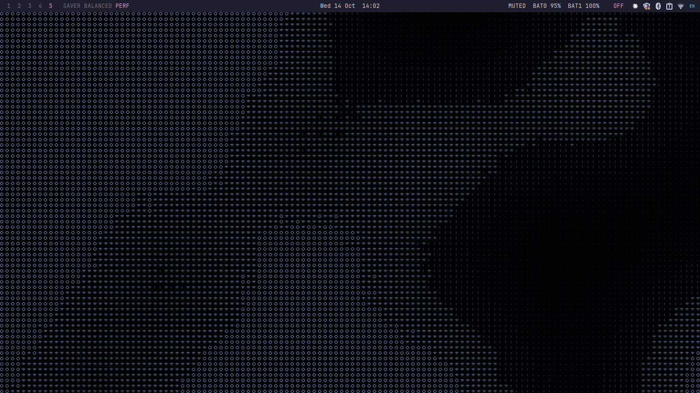
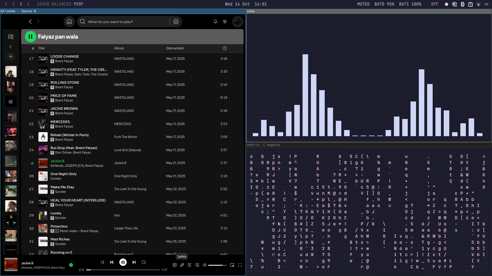

# Gaudi_OS

i3 + Polybar + rofi + picom + fastfetch on Linux Mint (ThinkPad T440), Catppuccin Mocha.

**this is a personal project, it has my linux mint setup and customisation catered to my workflow**

## About
Despite the name, this is not a Linux distribution. It's a desktop setup built on top of Linux Mint: i3, Polybar, rofi, picom and fastfetch, themed with Catppuccin Mocha. Take what you like.

## Art
The Paz ASCII art in `fastfetch/` is converted from artwork I didn't draw. It isn't covered by this repo's MIT license and belongs to its original artist. The "AHMED WAS HERE" lettering is mine.
